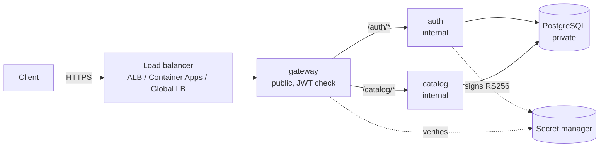

# Multicloud IaC Showcase

[](https://github.com/supercutethings/MultiCloudDemo/actions/workflows/apps-ci.yml)
[](https://github.com/supercutethings/MultiCloudDemo/actions/workflows/k8s-validate.yml)
[](LICENSE)
[](infra)
[](apps)

One microservice platform, deployed the same way to **AWS, Azure and GCP** with Terraform.
JWT authentication, a load balancer in front of the only public service, managed
PostgreSQL, secrets in each provider's secret manager, mutual TLS between services, and CI
that authenticates with short-lived OIDC tokens instead of stored cloud keys.

The point is not "Terraform can talk to three providers." The point is that **the
application is constant and the platform is the variable**, so every difference in cost,
IAM model, networking and operational surface has exactly one cause: the provider.

```
Client ──HTTPS──▶ Load balancer ──▶ gateway ──┬──▶ auth     ──┐
                                              └──▶ catalog  ──┴──▶ PostgreSQL
                                        (only the gateway is internet-facing)
```

## Contents

- [Status](#status)
- [Architecture](#architecture)
- [Quick start](#quick-start-2-minutes)
- [Deploy to AWS](#deploy-to-aws)
- [Deploy to Azure](#deploy-to-azure-container-apps)
- [Deploy to GCP](#deploy-to-gcp-cloud-run)
- [Deploy to Kubernetes](#deploy-to-kubernetes-eks--aks--gke)
- [Internal mutual TLS](#internal-mutual-tls)
- [Security decisions](#security-decisions-worth-a-look)
- [Cost](#cost-in-one-table)
- [Releases](#releases)
- [Roadmap](#roadmap)
- [Contributing](#contributing)
- [Architecture decisions](#decisions)
- [License](#license)

## Status

| Runtime | Cloud | Status | Where |
|---|---|---|---|
| ECS Fargate + ALB | AWS | ✅ end-to-end (RDS, Cloud Map, OIDC CI) | `infra/envs/aws/dev` |
| EKS + ALB Ingress | AWS | ✅ cluster, HPA + autoscaler, 3-AZ | `infra/envs/aws/eks`, `k8s/overlays/eks` |
| AKS + App Gateway | Azure | ✅ cluster, node autoscaler, 3-AZ | `infra/envs/azure/aks`, `k8s/overlays/aks` |
| GKE regional + GCLB | GCP | ✅ cluster, node autoscaler, 3-zone | `infra/envs/gcp/gke`, `k8s/overlays/gke` |
| Container Apps | Azure | ✅ environment, identity per app, scale to zero | `infra/envs/azure/dev` |
| Cloud Run | GCP | ✅ services, private Cloud SQL, Secret Manager, scale to zero | `infra/envs/gcp/cloudrun` |

Honest status beats a green badge. What exists runs; what does not is labelled.

## Architecture



Three services, one job each:

| Service | Responsibility | Why it exists |
|---|---|---|
| `gateway` | Validates JWTs, adds request ids, proxies | A single, auditable edge — see [ADR 0003](docs/adr/0003-gateway-at-the-edge.md) |
| `auth` | Register, login, refresh; holds the **only** copy of the signing key | RS256 means verifiers never need the private key |
| `catalog` | CRUD scoped to the token's user id | Shows authorisation, not just authentication |

Everything else is infrastructure: VPC with public/private tiers and chained security
groups, TLS listener, target group health checks on `/readyz`, Cloud Map DNS for
service-to-service calls, one IAM role per workload, and secrets injected at container
start — never baked into an image or a task definition.

## Quick start (2 minutes)

Requires Docker, `make`, `openssl`, `jq`.

```bash
make up      # builds the three images, starts Postgres, gateway on :8080
make smoke   # register -> login -> authenticated CRUD through the gateway
make down
```

`make smoke` is the same script CI runs against the deployed load balancer, so a local
pass and a cloud pass mean the same thing.

Run the test suite and the linter the same way CI does:

```bash
make test    # 36 unit tests, including real TLS handshakes
make lint    # ruff
make certs-expiry   # fail if any local certificate is within 7 days of expiry
```

## Deploy to AWS

```bash
# 1. one-time bootstrap: state bucket, lock table, GitHub OIDC role
cd infra/bootstrap/aws
terraform init
terraform apply -var="github_org=<you>" -var="github_repo=<repo>"

# 2. point the dev environment at that state
terraform output -raw backend_hcl > ../../envs/aws/dev/backend.hcl

# 3. add repository variables for CI: AWS_ROLE_ARN, AWS_REGION,
#    TF_STATE_BUCKET, TF_STATE_LOCK_TABLE (values from `terraform output`)

# 4. push to main: the apply workflow builds, pushes and deploys the images,
#    then smoke-tests the load balancer URL.
```

Manual deploy without CI:

```bash
cd infra/envs/aws/dev
terraform init -backend-config=backend.hcl
terraform apply -target=module.ecr                  # registries first
# build + push the three images tagged with a commit SHA...
terraform apply -var="image_tag=<sha>"
make smoke LOCAL_URL="$(terraform output -raw url)"
```

**Then `make destroy`.** The stack costs ≈ $95/month if you forget —
see [docs/cost.md](docs/cost.md) for the full breakdown, the surprisingly patchy free tier,
and seven cheaper alternatives (2-hour demo: **$0.26**).

## Deploy to Azure (Container Apps)

```bash
cd infra/envs/azure/dev
cp backend.example.hcl backend.hcl          # point it at your state account
terraform init -backend-config=backend.hcl
terraform apply                             # VNet, ACR, vault, database, environment

# The apps cannot start before the images exist, so push first.
PREFIX=$(terraform output -raw image_repository_prefix)
az acr login --name "$(terraform output -raw acr_login_server | cut -d. -f1)"
for service in auth catalog gateway; do
  docker build -f "apps/$service/Dockerfile" -t "$PREFIX/$service:1.0.0" .
  docker push "$PREFIX/$service:1.0.0"
done

terraform apply -var="image_tag=1.0.0"      # rolls the apps onto the pushed images
make smoke LOCAL_URL="$(terraform output -raw url)"
```

The database has no public endpoint, the vault is reached through a private endpoint, and
each app pulls images and reads secrets with its own managed identity — there is no
registry password and no connection string in the container definition. Internal services
scale to zero; the gateway keeps one replica warm so the URL answers immediately.

One honest difference from the other legs: Container Apps ingress terminates TLS and
forwards plaintext, so the internal hop is HTTP *inside* the environment instead of
application-level mTLS. The boundary still holds — only the gateway has external ingress —
but the transport guarantee does not, and [docs/cloud-matrix.md](docs/cloud-matrix.md) says so.

## Deploy to GCP (Cloud Run)

```bash
cd infra/envs/gcp/cloudrun
cp backend.example.hcl backend.hcl          # point it at your GCS bucket
terraform init -backend-config=backend.hcl
terraform apply                             # VPC + connector, registry, Cloud SQL, secrets

# A revision cannot start before its image exists, so push first.
PREFIX=$(terraform output -raw image_repository_prefix)
gcloud auth configure-docker "${PREFIX%%/*}"
for service in auth catalog gateway; do
  docker build -f "apps/$service/Dockerfile" -t "$PREFIX/$service:1.0.0" .
  docker push "$PREFIX/$service:1.0.0"
done

terraform apply -var="image_tag=1.0.0"      # rolls the services onto the pushed images
make smoke LOCAL_URL="$(terraform output -raw url)"
```

Cloud Run has no address inside the VPC, so every service sends egress through a
**Serverless VPC Access connector** — that is what lets the gateway reach an internal-only
service and what lets both services reach the private Cloud SQL address. Each service runs
as its own service account: only `auth` can read the JWT private key, and only the gateway
may invoke `auth` and `catalog`.

The public entrypoint is the `*.run.app` URL with a Google-managed certificate. A global
external HTTPS load balancer would add a stable IP and a custom domain for about $18/month,
and the contract does not need either, so it is documented in [docs/cost.md](docs/cost.md)
rather than deployed.

The same transport gap as Azure applies: Cloud Run terminates TLS and forwards plaintext,
so the internal hop is HTTP inside the VPC instead of application-level mTLS.

## Deploy to Kubernetes (EKS / AKS / GKE)

Same images, same env vars, same smoke test. One provider-neutral base and three overlays;
only the ingress, the secret store and the cluster change.

```bash
cd infra/envs/aws/eks && terraform init && terraform apply   # or azure/aks, gcp/gke
export CLUSTER_NAME=showcase-dev-k8s AWS_REGION=eu-west-1 VPC_ID=vpc-... \
       ESO_ROLE_ARN=... ALB_ROLE_ARN=... CA_ROLE_ARN=...
scripts/cluster-addons.sh eks                                  # cert-manager, Reloader, ESO, autoscaler, ALB

export IMAGE_REPO=$(terraform output -raw image_repository_prefix) \
       SECRETS_PREFIX=showcase/dev VPC_CIDR=10.20.0.0/16 CERTIFICATE_ARN=arn:aws:acm:...
bash scripts/k8s-render.sh eks | kubectl apply -f -            # refuses to render with gaps

make loadtest LOCAL_URL=https://... SCENARIO=login CONCURRENCY=60 DURATION=120
kubectl -n showcase get hpa,deploy,pods -w                     # watch it scale
```

What is there: three-zone node pools, HPA (3→24 gateway) feeding Cluster Autoscaler, PDBs,
topology-spread pods, `restricted` Pod Security Admission, default-deny NetworkPolicies, no
service-account token in any pod, and secrets pulled from each cloud's secret manager by a
federated identity. Zone loss, node drain, pod crash and DB failover are each answered by a
specific control — [the map is here](docs/kubernetes.md#high-availability-what-protects-against-what).

Why it is fair to compare: [ADR 0004](docs/adr/0004-kubernetes-parity.md).

## Internal mutual TLS

The edge is HTTPS; the hop behind it was not. Now the gateway authenticates to auth and
catalog with a client certificate, and both verify it during the TLS handshake on 8443 —
no request handler, router or database dependency ever sees an unauthenticated caller.
Probes use a separate plaintext ops port (8000) that serves `/healthz` and `/readyz` and
nothing else, because neither a kubelet nor a load balancer can present a certificate.

```bash
make certs          # local PKI: server CA, per-caller CA, leaves (.certs/, gitignored)
make up             # compose runs the internal hops over mTLS
make smoke          # full flow through the gateway
make mtls-check     # no certificate, unlisted issuer and plaintext are all rejected
make certs-expiry   # fail if anything is within 7 days of expiry
make loadtest-mtls  # what the handshake costs per new connection
make loadtest-rotate # swap the caller certificate mid-run and watch the allow rule
```

There are **two trust domains, not one CA**. The server CA signs what auth and catalog
present; one client CA per caller identity signs what a caller presents. A service mounts
only the caller CAs it allows (`TLS_CLIENT_CA_DIR`), so a new internal service needs an
explicit allow rule rather than merely a certificate — the check happens during the
handshake, where uvicorn can actually enforce it.

On Kubernetes, **cert-manager issues and rotates the leaves** (30 days, renewed at 10 days,
new key every time), Reloader rolls the pods so the renewal reaches the process, and
Prometheus alerts at 21 and 7 days. The CA keys never reach a workload, so a compromised
pod cannot mint identities. On ECS the same hierarchy comes from `infra/modules/pki`. Why
it is built this way, and what it costs:
[ADR 0005](docs/adr/0005-internal-mutual-tls.md) ·
[ADR 0006](docs/adr/0006-cert-manager-internal-pki.md).

## Repository map

```
apps/         three FastAPI services + shared config, logging, security, db, TLS helpers
  tests/      36 unit tests, including handshake tests against a real listener
k8s/
  base/       namespace, deployments, HPA, PDB, NetworkPolicy (no cloud-specific field)
  components/ internal PKI: cert-manager issuers and certificates, identical per cloud
  overlays/   eks | aks | gke: ingress, secret store, database network policy
  monitoring/ certificate-expiry alerts (applied with MONITORING=1)
infra/
  contracts/  the provider-neutral interface every cloud module must satisfy
  bootstrap/  per-cloud state backend and CI trust (applied once, by a human)
  modules/    reusable provider modules (network, ecr, rds, service, alb, pki, eks)
  envs/       environments composed from modules (aws/dev, aws/eks, azure/dev, azure/aks, gcp/cloudrun, gcp/gke)
platform/
  policies/   Conftest rules the plan and the manifests must pass before they can apply
scripts/      local PKI, smoke test, mTLS checks, load test, renderer, add-ons
docs/         ADRs, cloud matrix, cost model, Kubernetes runbook
```

## Security decisions worth a look

* **No static cloud credentials.** GitHub Actions assumes an AWS role, or exchanges a GitHub
  OIDC token for an Entra ID token, pinned to this repository's `pull_request`, `main` and
  `environment:*` subjects — [ADR 0002](docs/adr/0002-oidc-no-static-credentials.md) ·
  [docs/ci.md](docs/ci.md).
* **Only one public service.** The ALB has one target group; `auth` and `catalog` accept
  traffic only from the gateway's security group, and each verifies the JWT anyway.
* **Mutual TLS behind the edge.** Transport identity is verified in the handshake, before
  any application code runs, and the trust bundle is per-service and per-caller.
* **RS256, scrypt, constant-time comparisons.** The private key exists only in the auth
  container; passwords are memory-hard hashes, not SHA-256.
* **Nothing secret in the image or the task definition.** Secrets are resolved by the ECS
  execution role at start-up from Secrets Manager.
* **Least privilege where it is cheap to be.** One task role per service, an execution
  role scoped to two secret ARNs, and a CI role limited to creating `${project}-*` roles.
* **Policy as code in CI.** A plan that opens a port to the world or leaves RDS unencrypted
  fails before apply (`platform/policies`).

## Cost, in one table

| | Always-on | Ephemeral (2 h demo) | Free tier? |
|---|---|---|---|
| AWS (ECS) | ≈ $95/mo | ≈ $0.26 | No |
| Azure (Container Apps) | ≈ $0–68/mo | ≈ $0.19 | Yes, year one |
| GCP (Cloud Run) | ≈ $13–32/mo | ≈ $0.09 | $300 credit, 90 days |
| **AWS (EKS)** | ≈ $295/mo | ≈ $0.80 | No — control plane + 3 NATs |
| **Azure (AKS)** | ≈ $150/mo | ≈ $0.41 | Control plane is free |
| **GCP (GKE regional)** | ≈ $215/mo | ≈ $0.59 | $300 credit |

Kubernetes costs roughly 2–3× the serverless legs for the same three services: you are
paying for a control plane, a minimum of three nodes and (on AWS) three NAT gateways. That
trade is the point of the comparison, not an accident — [breakdown](docs/cost.md#kubernetes-eks--aks--gke).

Full component-level breakdown and cheaper variants: [docs/cost.md](docs/cost.md).

What breaks first under load, and what I would change in what order:
[docs/at-10x.md](docs/at-10x.md).

## Releases

Versions track repository milestones rather than calendar time: each one is a working,
deployable state of the platform, and the changelog records what changed and why.

| Version | Milestone | Highlights |
|---|---|---|
| **v0.6.0** | Phase 4: hardening | Contract tests against mocked providers, daily drift detection that opens and closes its own issue, a manual ephemeral apply that must destroy itself, a k6 load scenario with thresholds, and the JWT rotation runbook |
| **v0.5.0** | GCP serverless leg + Azure CI | Cloud Run behind a Serverless VPC connector, private Cloud SQL, Secret Manager per secret, one service account per service; Azure plan/apply in CI with OIDC federated credentials |
| **v0.4.0** | Azure serverless leg | Container Apps injected into a VNet, one managed identity per app, Flexible Server with no public endpoint, Key Vault behind a private endpoint, ACR with the admin account disabled, scale to zero when idle |
| **v0.3.0** | Internal PKI and mutual TLS | Two trust domains, app-level mTLS on 8443, cert-manager issuance and rotation, Reloader rollout, expiry alerts at 21/7 days, policy rules for `Certificate` hygiene |
| **v0.2.0** | Kubernetes runtime | EKS, AKS and GKE from one base, three-AZ node pools, HPA + node autoscaling, PDBs, default-deny NetworkPolicies, federated secret access, renderer that refuses incomplete overlays |
| **v0.1.0** | AWS serverless leg | FastAPI services, local Compose stack, network/ECR/RDS/ECS/ALB modules, Cloud Map, OIDC CI, Conftest guardrails |

### Changelog

**v0.6.0 — Phase 4: hardening**

* Added `tests/terraform/`: `terraform test` with mocked AWS, Azure and GCP providers that
  asserts the contract in `infra/contracts/README.md` — internal URL, public URL, log
  destination, and one workload identity per app. No credentials, no account, seconds to run.
* The contract test found a real bug on its first run: the Container Apps probes used
  `transport = "Http"`, which `terraform validate` accepts and the provider rejects at apply
  time (`HTTP`/`TCP`/`HTTPS`). Fixed in the module; the test is what would have caught it.
* Added `terraform-drift`: a daily `plan -detailed-exitcode` per cloud that opens, refreshes
  and closes one issue per environment, so a change made in the console is visible instead
  of silent.
* Added `terraform-ephemeral`: a manual apply → smoke → destroy run on a separate state key
  with `environment=ephemeral`, ending in a `plan -detailed-exitcode` that fails if the
  destroy left anything behind.
* Added `scripts/loadtest.k6.js`: the k6 counterpart of `loadtest.py`, with thresholds that
  fail a run (p95 login < 1.5 s, p95 catalog < 500 ms, error rate < 5%).
* Added [docs/jwt-rotation.md](docs/jwt-rotation.md): what a rotation actually costs — a
  forced re-login for up to `ACCESS_TOKEN_TTL_SECONDS`, because there is one key and no
  `kid` — plus the per-cloud procedure, verification and rollback.

**v0.5.0 — GCP serverless leg and Azure CI**

* Added `infra/modules/gcp/{network,artifact_registry,cloud_sql,secret_manager,cloud_run}`:
  a VPC with a Serverless VPC Access connector, a registry with a cleanup policy, Cloud SQL
  with a private IP only, Secret Manager with per-service accessors, and the services
  themselves with internal ingress for everything except the gateway.
* Added `infra/envs/gcp/cloudrun`: three services, one service account each, secrets
  resolved by `secret_key_ref`, gateway upstream URLs read from the real service URIs.
* Two new Conftest rules: no public IP on Cloud SQL, and no Cloud Run service other than
  the gateway accepting internet traffic.
* Added Azure `plan` and `apply` jobs with OIDC federated credentials, plus
  `scripts/azure-oidc-bootstrap.sh` for the one-time app registration and state account.
* Added [docs/ci.md](docs/ci.md): the OIDC subjects, the repository variables per cloud,
  and the two-phase apply that makes an image exist before the workload that needs it.

**v0.4.0 — Azure serverless leg**

* Added `infra/modules/azure/{network,acr,postgres,key_vault,container_apps}`: a VNet with
  three dedicated subnets, a registry with no admin account, a Flexible Server with no
  public endpoint, a vault reached through a private endpoint, and the environment plus
  apps themselves.
* Added `infra/envs/azure/dev`: three services on Container Apps, one user-assigned identity
  per app, secrets resolved from Key Vault by that identity, and gateway upstream URLs read
  from the real internal FQDNs instead of an assembled hostname.
* Three new Conftest rules: no publicly reachable Flexible Server, no Container App with
  `allow_insecure_connections`, no ACR admin account.
* CI now validates the Azure modules and environment alongside the AWS ones.
* Documented the one genuine gap: Container Apps ingress terminates TLS, so the internal
  hop is HTTP inside the environment rather than application-level mTLS.

**v0.3.0 — internal PKI and mutual TLS**

* Added `apps/common/tls.py` and `apps/common/serve.py`: TLS material from files or inline
  PEM, client CA bundles from a directory, `CERT_REQUIRED` by default, fail-closed start-up.
* Split the data plane (8443, mTLS) from the ops plane (8000, `/healthz` and `/readyz` only).
* Added `k8s/components/internal-pki`: self-signed bootstrap → server CA and per-caller
  client CA → 30-day leaves with `rotationPolicy: Always`, renewed 10 days before expiry.
* Added `k8s/monitoring/certificates.yaml`: alerts at 21 and 7 days, `NotReady`
  certificates, CA younger than a year, plus a ServiceMonitor for cert-manager.
* Added `scripts/mtls-check.sh`, `scripts/cert-expiry.sh` and the `handshake` / `rotate`
  load-test scenarios.
* Added Conftest rules for certificate hygiene and for Reloader on Secret volumes.
* Documented the decision in [ADR 0006](docs/adr/0006-cert-manager-internal-pki.md).

**v0.2.0 — Kubernetes runtime**

* Provider-neutral `k8s/base` with `restricted` PSA, HPA v2, PDBs, topology spread and
  default-deny NetworkPolicies.
* Three overlays with a renderer (`scripts/k8s-render.sh`) that fails on any unresolved
  placeholder instead of applying a half-filled manifest.
* `scripts/cluster-addons.sh` per cloud: cert-manager and Reloader everywhere, plus the
  autoscaler, ALB controller and metrics-server only where the provider does not ship them.
* `docs/kubernetes.md`: topology, autoscaling behaviour, HA map, and an explicit
  "verified vs. not verified" section.

**v0.1.0 — AWS serverless leg**

* Three FastAPI services with RS256 JWTs, scrypt password hashing and request-scoped logs.
* Reusable Terraform modules (network, ECR, RDS, ECS service, ALB) behind a contract.
* GitHub Actions: build/test/lint, image scan, `terraform plan` with policy checks, and an
  OIDC-authenticated apply that smoke-tests the deployed URL.

### Unreleased

* Phase 5 — packaging: the [10× traffic analysis](docs/at-10x.md) is written; the recorded
  demo and the per-cloud cost screenshots need a live deployment and a screen, so they are
  open rather than done.
* GCP CI authentication and state — done, unreleased: `infra/bootstrap/gcp` creates the
  Workload Identity Federation pool, its GitHub provider, the CI service account and the
  GCS state bucket, and `terraform-plan` / `terraform-apply` have a `gcp/cloudrun` job behind
  `vars.GCP_WORKLOAD_IDENTITY_PROVIDER`. The last two 🚧 rows in
  [docs/cloud-matrix.md](docs/cloud-matrix.md) are now ✅.
* GCP drift detection: the federation pool exists now, so `terraform-drift` can grow the
  third job it could not have before.

## Roadmap

* **Phase 1 — AWS (done):** app, local stack, network/ECR/RDS/ECS/ALB modules, OIDC CI, policies.
* **Phase 1.5 — Kubernetes (done):** EKS, AKS and GKE with three-AZ node pools, HPA + node
  autoscaling, PDBs, default-deny NetworkPolicies, federated secret access, load test.
* **Phase 2 — Azure serverless (done):** Container Apps + Flexible Server + Key Vault + ACR,
  VNet-injected, one managed identity per app, scale to zero when idle.
* **Phase 3 — GCP serverless (done):** Cloud Run + Cloud SQL + Secret Manager behind a VPC
  connector, one service account per service, and Azure plan/apply in CI with OIDC.
* **Phase 4 — Hardening (done):** contract tests against mocked providers, daily drift
  detection, a manual ephemeral apply that must destroy itself, a k6 load scenario, and the
  JWT rotation runbook.
* **Phase 5 — Packaging (partly done):** [what I would change at 10× traffic](docs/at-10x.md)
  is written; the recorded demo and per-cloud cost screenshots need a live deployment.

## Contributing

Contributions are welcome — from a typo in a runbook to a whole new cloud leg. The project
is deliberately small enough that a first pull request does not require reading everything.

### Good first contributions

| Area | What would help | Where to start |
|---|---|---|
| Documentation | Fix a stale command, clarify a runbook step, add a diagram | `docs/` |
| Cost model | Re-measure a line item and update the table with the date you measured | `docs/cost.md` |
| Tests | Cover the auth error paths, add a Compose-level smoke variant | `apps/tests/` |
| Policies | New Conftest rule with a failing and a passing fixture | `platform/policies/` |
| Kubernetes | Add a `kustomize` component for a second internal service | `k8s/components/` |
| Tests | Extend the contract tests to a network or database module | `tests/terraform/` |

### Development setup

```bash
git clone https://github.com/supercutethings/MultiCloudDemo.git
cd MultiCloudDemo
python3.12 -m venv .venv && . .venv/bin/activate
pip install -r apps/auth/requirements.txt -r apps/catalog/requirements.txt \
            -r apps/gateway/requirements.txt pytest ruff

make keys certs     # local RS256 keys and mTLS material, both gitignored
make up             # Postgres + the three services
make smoke          # end-to-end check through the gateway
make test lint      # the same checks CI runs
```

Terraform changes additionally need Terraform ≥ 1.6 (`terraform fmt -check -recursive` and
`terraform validate` in every module), and Kubernetes changes need `kubectl`, `kustomize`,
`kubeconform` and `conftest` — the exact invocations are in `.github/workflows/`.

### Before you open a pull request

1. **Open an issue first** for anything larger than a bug fix or a doc tweak, so the design
   can be agreed before the code exists. Small fixes can go straight to a PR.
2. **Keep the contract intact.** Infrastructure modules must satisfy
   `infra/contracts`; if a change needs a new output or variable, change the contract and
   every implementation in the same PR.
3. **Record decisions, not just diffs.** Anything that changes a trust boundary, a
   provider's role in the architecture or an operational assumption gets an ADR in
   `docs/adr/` (copy the format of an existing one; status starts as `proposed`).
4. **Run the checks locally:** `make test lint`, plus `make k8s-render CLOUD=eks` and
   `bash scripts/cert-expiry.sh` when you touch manifests or certificates.
5. **Update the changelog** in the *Unreleased* section above and, if you add a capability,
   the status table and [docs/cloud-matrix.md](docs/cloud-matrix.md).

### Commit and branch conventions

* Branches: `feat/<short-name>`, `fix/<short-name>`, `docs/<short-name>`.
* Commits follow [Conventional Commits](https://www.conventionalcommits.org/):
  `feat(k8s): ...`, `fix(apps): ...`, `docs(cost): ...`. One logical change per commit;
  a reviewer should be able to revert it on its own.
* Write the *why* in the body when the diff alone does not explain it. "Bump the timeout"
  is a diff; "the ALB idle timeout was shorter than the slowest catalog query" is a commit.

### Review and CI

Every pull request runs the app pipeline (ruff, pytest, image build and Trivy scan),
manifest validation (`kustomize` render, `kubeconform -strict`, `conftest`) and
`terraform fmt`/`validate`. A plan is posted as a comment when cloud credentials are
available — an AWS role, an Azure federated credential or a GCP workload identity provider
([docs/ci.md](docs/ci.md)). Merges require a green run; nothing is merged on a red badge.

### Community

* **Questions and ideas:** open a discussion or an issue with the `question` label.
* **Bugs:** include the cloud, the command you ran, and the relevant log lines with any
  secret values redacted.
* **Security issues:** please **do not** open a public issue. Report privately through
  GitHub's *Security → Report a vulnerability* so a fix can ship before disclosure.
* **Code of conduct:** be decent. Harassment, dismissiveness and gatekeeping are not
  welcome here; maintainers may remove comments or contributions that make the project
  worse to participate in.
* **Credit:** contributors are listed in the release notes for the version that includes
  their change.

## Decisions

Architecture decisions live in [`docs/adr`](docs/adr):
[0001 one app, three clouds](docs/adr/0001-one-app-three-clouds.md) ·
[0002 no static credentials](docs/adr/0002-oidc-no-static-credentials.md) ·
[0003 gateway at the edge](docs/adr/0003-gateway-at-the-edge.md) ·
[0004 Kubernetes as a second runtime](docs/adr/0004-kubernetes-parity.md) ·
[0005 internal mutual TLS](docs/adr/0005-internal-mutual-tls.md) ·
[0006 cert-manager issues the internal PKI](docs/adr/0006-cert-manager-internal-pki.md).

## Notes

* Terraform ≥ 1.6 is required; OpenTofu works with the same HCL.
* The application is Python 3.12 / FastAPI. Swapping the language changes nothing below
  the container boundary — the infrastructure only knows an image and a port.
* MIT licensed — see [LICENSE](LICENSE).
