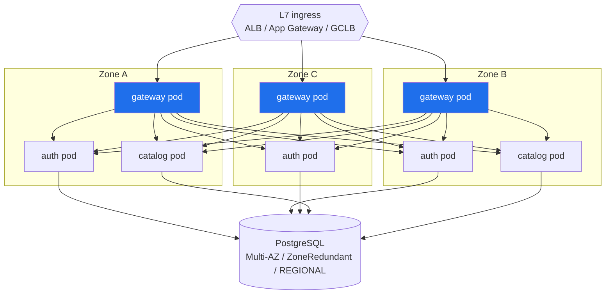

# Kubernetes path: EKS, AKS and GKE

The ECS stack in `infra/envs/aws/dev` answers "can you run this on one managed runtime?".
This page answers the harder question a senior platform role actually asks: **can the same
application move between three managed Kubernetes offerings, keep its security properties,
survive the loss of an availability zone, and scale under a traffic spike without a human?**

Same container images, same environment variables, same `/healthz` and `/readyz`
contracts, same smoke test. Only the cluster, the ingress and the secret store change.

| | EKS | AKS | GKE |
|---|---|---|---|
| Cluster Terraform | `infra/modules/aws/eks` | `infra/modules/azure/aks` | `infra/modules/gcp/gke` |
| Environment | `infra/envs/aws/eks` | `infra/envs/azure/aks` | `infra/envs/gcp/gke` |
| Manifests | `k8s/overlays/eks` | `k8s/overlays/aks` | `k8s/overlays/gke` |
| Ingress | AWS Load Balancer Controller (ALB) | Application Gateway (AGIC) | GCE Ingress + ManagedCertificate |
| Node autoscaling | Cluster Autoscaler (Helm + IRSA) | AKS node autoscaler (built in) | GKE Cluster Autoscaler (built in) |
| Secrets | Secrets Manager → ESO (IRSA) | Key Vault → ESO (workload identity) | Secret Manager → ESO (Workload Identity) |
| Pod identity | none needed | none needed | none needed |

## Topology



Every pod set starts with at least two replicas spread across zones, the ingress probes
`/readyz`, and a PodDisruptionBudget keeps the service up while nodes are drained.

## Three autoscaling layers, and why all three are needed

| Layer | Object | Bounds | What it reacts to |
|---|---|---|---|
| Pods | `HorizontalPodAutoscaler` (gateway 3→24, auth 2→10, catalog 2→12) | CPU utilisation 65–70% of *requests* | traffic |
| Nodes | Cluster Autoscaler / AKS+GKE managed autoscaler | 3→12 nodes (general pool) | pods that cannot be scheduled |
| Ceiling | `ResourceQuota` + node max size + HPA max | 12 vCPU requested, 24 limit | the bill |

They are a chain, and each link has a failure mode worth knowing:

* **HPA without a node autoscaler** scales pods into `Pending`. `kubectl describe pod` shows
  `0/3 nodes are available: insufficient cpu`. This is the most common "autoscaling doesn't
  work" report, and it is a missing node layer, not a broken HPA.
* **Node autoscaler without requests** cannot bin-pack. A pod without
  `resources.requests.cpu` is treated as requesting zero, so the scheduler keeps stuffing
  nodes and the autoscaler never scales out. Hence the policy rule in
  `platform/policies/kubernetes.rego` and the `LimitRange` defaults in `k8s/base/limits.yaml`.
* **Scale-out without scale-in policies** flaps. The HPAs use a 0-second scale-up window
  (spikes are real) and a 300-second scale-down window with a 25%/min policy (a second wave
  should not cause a second cold start).
* **PDB larger than the minimum replica count** blocks the node autoscaler from ever
  draining a node, so scale-in never happens. The PDBs are written against the HPA
  `minReplicas`, not `maxReplicas`.

### Why the topology spread is soft

`k8s/base/deployment-gateway.yaml` uses `whenUnsatisfiable: ScheduleAnyway` for the zone
constraint. A hard constraint (`DoNotSchedule`) with `maxSkew: 1` is correct only while
`replicas ≤ zones`: the fourth pod in a three-zone cluster can never satisfy the skew and
stays `Pending` forever, which turns an HPA scale-out into an outage. Soft spreading still
scores zones evenly (the scheduler prefers the emptiest zone) and keeps scaling unblocked.
If you need a hard guarantee, set `maxReplicas` to a multiple of the zone count and add
`minDomains: 3`.

## High availability: what protects against what

| Failure | Protection | Where |
|---|---|---|
| Pod crashes | 2–3 replicas + readiness probe + rolling update `maxUnavailable: 0` | deployments |
| Node drained (upgrade) | PodDisruptionBudget `minAvailable: 2` on the gateway | `k8s/base/pdb.yaml` |
| Node lost / Spot reclaim | zone-spread pods, autoscaler replaces the node | deployments + cluster module |
| **Availability zone lost** | node pool spans 3 zones, pods spread across them, per-AZ NAT (AWS), zone-redundant DB | env roots |
| Database primary lost | RDS `multi_az`, Flexible Server `ZoneRedundant`, Cloud SQL `REGIONAL` | env roots |
| Traffic spike | HPA → node autoscaler → node pool max | `k8s/base/hpa.yaml` + cluster modules |
| Bad deploy | readiness gate + `maxUnavailable: 0` + (AWS) deployment circuit breaker on the ECS path | deployments |
| Ingress controller down | 2+ controller replicas, managed L7 on Azure/GCP | add-ons |

One honest caveat: on AWS a single NAT gateway would be an AZ single point of failure, which
is why `infra/envs/aws/eks` sets `nat_gateway_per_az = true` (~$99/month instead of $33).
The ECS environment deliberately keeps the cheap single NAT, and `docs/cost.md` says so.

## Security posture

| Control | Implementation |
|---|---|
| Pod Security Admission | namespace labelled `restricted` (enforce + audit + warn) |
| Non-root | images run as uid 10001; `runAsNonRoot`, `runAsUser`, `fsGroup` set explicitly |
| Immutable root filesystem | `readOnlyRootFilesystem: true` + `emptyDir` for `/tmp` |
| Least privilege | `capabilities.drop: [ALL]`, `allowPrivilegeEscalation: false`, `seccompProfile: RuntimeDefault` |
| No API credentials in pods | `automountServiceAccountToken: false` on every workload |
| No static cloud keys | IRSA (EKS), workload identity (AKS/GKE), federated credentials for ESO only |
| Default-deny network | `default-deny` NetworkPolicy + explicit DNS, ingress→gateway, gateway→auth/catalog, →Postgres:5432 |
| DB egress scoped | overlay narrows 5432 to the VPC/VNet CIDR |
| Secrets out of git | External Secrets pulls from the cloud secret manager at runtime |
| Private nodes | EKS private subnets, AKS private cluster option, GKE private nodes |
| Control-plane audit | EKS all five log types, AKS diagnostic settings, GKE audit logs |
| Supply chain | images pinned by tag (digest recommended), Trivy scan in `apps-ci`, Azure Policy / Binary Authorization |
| **Internal service calls** | **mutual TLS on 8443**: server certificate verified against the platform CA, gateway presents a client certificate, handshake-level rejection |
| Policy in CI | `platform/policies/kubernetes.rego` runs on every rendered overlay |

The deliberate omission: **the application pods have no cloud identity at all**. They never
call a cloud API, so there is nothing for a compromised container to assume. Secrets reach
them as Kubernetes Secrets written by the operator, whose identity is the only one with
`secretsmanager:GetSecretValue` / `Key Vault Secrets User` / `secretmanager.secretAccessor`,
scoped to the three secrets this platform owns.

## Mutual TLS on the internal hops

The edge is TLS (ALB / App Gateway / GCLB). The hop *behind* the edge is where the
password and the bearer token travel, and on ECS it was plaintext HTTP. Now every internal
hop is mutually authenticated:

| Port | Listener | Who may connect | Contents |
|---|---|---|---|
| **8443** | data, TLS 1.2+ | callers presenting a certificate signed by an *allowed* caller CA | login, tokens, catalog data |
| **8000** | ops, plaintext | kubelet, load balancer | `/healthz`, `/readyz` only |
| 8000 (gateway) | public, plaintext behind the ingress | the ingress controller | user API |

How it is enforced, in order:

1. `TLS_CERT_FILE` / `TLS_KEY_FILE` are mounted from the `auth-mtls`, `catalog-mtls` and
   `gateway-mtls` Secrets, which **cert-manager** issues (`k8s/components/internal-pki`).
   `apps/common/serve.py` builds the listener from them; nothing certificate-related comes
   from External Secrets.
2. On the server side `ssl_cert_reqs=CERT_REQUIRED` + `ssl_ca_certs`: a client without a
   certificate is rejected **during the handshake**. No request handler, router or database
   dependency ever sees it.
3. On the client side the gateway verifies the server certificate *and* the hostname
   (`auth`, `catalog`) against the CA, then presents its own `clientAuth` certificate.
4. NetworkPolicy restricts 8443 to gateway pods; the certificate is the second, independent
   lock. Both must fail for an attacker to get in.
5. **The caller is authorised by its issuer, not merely by being well-formed.** auth and
   catalog mount `/tls/clients`, a projected volume with one file per *allowed* caller
   identity, and `common.tls` builds the verification bundle from those files
   (`TLS_CLIENT_CA_DIR`). A perfectly valid client certificate from any other CA is refused
   during the handshake — proven by `scripts/mtls-check.sh` and `apps/tests/test_mtls.py`.
   Onboarding a service is therefore a reviewable change: its CA in that volume, its pods in
   the NetworkPolicy.
6. The certificate is transport identity only. `/catalog/items` without a JWT still returns
   401 — proven by `scripts/mtls-check.sh`.

Probes are why the ops port exists: neither the kubelet nor an ALB can present a client
certificate, and weakening 8443 to `CERT_OPTIONAL` to accommodate them would defeat the
point. The ops listener serves two endpoints and touches no data.

### Issuance, rotation and the allow rule

Two trust domains, both issued in-cluster by **cert-manager**
([ADR 0006](adr/0006-cert-manager-internal-pki.md)):

```
Issuer showcase-bootstrap (selfSigned)
  ├─ Certificate showcase-server-ca            isCA, 5y, key rotation Never
  │    └─ Issuer showcase-server-ca  ──▶ auth-tls, catalog-tls      (30d, renew at 10d)
  └─ Certificate showcase-client-ca-gateway    isCA, 5y, key rotation Never
       └─ Issuer showcase-client-ca-gateway ──▶ gateway-client      (30d, renew at 10d)
```

Leaves are 30 days with `renewBefore: 240h` and a fresh private key on every renewal. The
Secret is rewritten in place, which a running process does not notice — so the Deployments
carry `reloader.stakater.com/auto: "true"` and Reloader turns the renewal into a rolling
restart. A policy rule in CI rejects a Deployment that mounts a Secret volume without it,
because "the Certificate is Ready" and "the pod is serving it" are different facts.

```bash
kubectl -n showcase get certificate,issuer           # issuance state
kubectl -n showcase describe certificate auth-tls    # why is it not renewing?
scripts/cert-expiry.sh --kube                        # no Prometheus needed
make certs-expiry                                    # the local .certs tree
```

Alerts (`k8s/monitoring/certificates.yaml`, applied by
`MONITORING=1 scripts/cluster-addons.sh <cloud>`) fire at 21 days, at 7 days, and whenever a
`Certificate` is not `Ready`. They are the backstop for a broken renewal, not the renewal
itself.

The CA keys live in `showcase-server-ca` / `showcase-client-ca-gateway` Secrets and are
never mounted into a workload, so a compromised pod cannot mint an identity — only present
its own leaf, to services whose allow rule names its CA. A production estate would put
these behind a Vault issuer or ACM PCA and keep the key in an HSM; the component is
swappable because the Deployments only know the three Secret names.

## Deploy runbook

Identical shape on all three clouds; only the variables change.

```bash
# 1. Cluster (15-20 min; the control plane is the slow part)
cd infra/envs/aws/eks     # or azure/aks, or gcp/gke
terraform init -backend-config=backend.hcl
terraform apply

# 2. Point kubectl at it
#    aws eks update-kubeconfig --name showcase-dev-k8s --region eu-west-1
#    az aks get-credentials -g showcase-dev-rg -n showcase-dev-aks
#    gcloud container clusters get-credentials showcase-dev-gke --region europe-west1

# 3. Cluster add-ons (cert-manager, Reloader, External Secrets, autoscaler, ingress)
#    Add MONITORING=1 to also install kube-prometheus-stack + the certificate alerts.
export ESO_ROLE_ARN=...   ALB_ROLE_ARN=...   CA_ROLE_ARN=...
export CLUSTER_NAME=showcase-dev-k8s AWS_REGION=eu-west-1 VPC_ID=vpc-...
scripts/cluster-addons.sh eks

# 4. Application
export IMAGE_REPO=$(terraform output -raw image_repository_prefix)   # e.g. 1234.dkr.ecr.eu-west-1.amazonaws.com/showcase
export AWS_REGION=eu-west-1 SECRETS_PREFIX=showcase/dev VPC_CIDR=10.20.0.0/16
export CERTIFICATE_ARN=arn:aws:acm:...:certificate/...
bash scripts/k8s-render.sh eks | kubectl apply -f -

# 5. Prove it
kubectl -n showcase rollout status deploy/gateway
make smoke LOCAL_URL="https://$(kubectl -n showcase get ingress gateway -o jsonpath='{.status.loadBalancer.ingress[0].hostname}')"

# 6. Break it on purpose (see below)
make loadtest LOCAL_URL=https://... SCENARIO=login CONCURRENCY=60 DURATION=120
```

`scripts/k8s-render.sh` refuses to emit YAML when a required value is missing or a
placeholder would survive substitution — a half-rendered overlay is worse than no overlay.

Images: `scripts/k8s-render.sh` rewrites `ghcr.io/example/showcase-<svc>` to
`$IMAGE_REPO/<svc>:${IMAGE_TAG}`. Build and push the three images with the existing
Dockerfiles (build context is the repo root, as in the ECS workflow).

## The load test, and what to watch

`scripts/loadtest.py` exists to make the autoscaler visible rather than theoretical.

* `--scenario login` hits `/auth/login`, which runs **scrypt** (memory-hard, deliberately
  expensive). This is the CPU driver: with 40 concurrent clients, `auth` and the gateway
  saturate faster than any synthetic endpoint would, and the HPA reacts within ~30 seconds.
* `--scenario catalog` exercises gateway → catalog → PostgreSQL. It is I/O-bound, so it
  shows where more replicas help less and where the database becomes the limit.
* `--scenario mixed` sends 30% logins, 70% reads.

Watch the chain in two terminals:

```bash
kubectl -n showcase get hpa,deploy,pods -w
kubectl -n showcase get nodes -w
```

What a healthy result looks like (values are shape, not a promise — they depend on node
size and region):

```
NAME      REFERENCE            TARGETS         MINPODS  MAXPODS  REPLICAS
gateway   Deployment/gateway   cpu: 12%/65%    3        24       3
gateway   Deployment/gateway   cpu: 88%/65%    3        24       6     <- scale out
gateway   Deployment/gateway   cpu: 71%/65%    3        24       14
gateway   Deployment/gateway   cpu: 30%/65%    3        24       14    <- 300s cooldown
gateway   Deployment/gateway   cpu: 18%/65%    3        24       10    <- 25%/min scale in
```

If `REPLICAS` stays at the minimum while `TARGETS` is high, the metrics pipeline is the
problem (`kubectl top pods` fails on EKS without metrics-server). If `REPLICAS` rises but
pods stay `Pending`, the node layer is missing or the node pool max is too low.

Measured locally (three uvicorn processes on one laptop, no cluster), which is the floor,
not a benchmark: login at concurrency 8 sustained ~6.7 requests/s at 1.2 s p50 — scrypt is
the bottleneck exactly as intended.

## Verified vs. not verified

Checked on this machine, offline:

* `kubectl kustomize` renders all three overlays: 39/39/42 objects, no placeholder left —
  including both issuers, both CA Certificates and the three leaves.
* `kubeconform -strict` against the upstream Kubernetes schemas: **0 invalid, 0 errors**
  (the 12–14 "skipped" objects are CRDs: ExternalSecret, ClusterSecretStore, BackendConfig,
  ManagedCertificate, Certificate, Issuer).
* Policy: **1170 assertions** on EKS and AKS, **1260** on GKE, all passing — including the
  certificate-lifetime, CA-key-rotation and Secret-volume-reloader rules.
* `scripts/k8s-render.sh` fails closed when a required variable is missing.
* **mTLS, with real handshakes, against a live listener:** `scripts/mtls-check.sh` asserts
  four things — no certificate rejected, a *valid certificate from an unlisted issuer*
  rejected, the gateway certificate accepted, and 401 without a JWT. The pytest suite covers
  the same ground at unit level, plus the projected-volume trust directory and the
  empty-directory failure.
* **Handshake cost and rotation impact, measured** (`scripts/loadtest.py`): six fresh
  handshakes p50 8.8 ms against 2.4 ms on a reused connection (~6.4 ms of handshake on a
  laptop, which is the floor, not a benchmark); a swap to a certificate from an unlisted CA
  was refused on every subsequent handshake while the previously authenticated caller kept
  working.
* `scripts/cert-expiry.sh` reports every certificate and fails under the threshold.
* All 50 HCL files parse; `platform/policies/kubernetes.rego` is exercised in CI.

Not verified here: `terraform validate` (no Terraform binary on this machine) and an actual
`terraform apply` against a live subscription. The cluster modules are written against the
documented provider schemas (`aws ~> 5.60`, `azurerm ~> 4.0`, `google ~> 6.0`); run
`terraform validate` before the first apply.

## What this deliberately does not include

* **No service mesh.** Internal mTLS is implemented per hop (see above) rather than by a
  mesh. Rotation and issuance are automated (cert-manager), but a *new* service still needs
  a `Certificate`, a CA entry in the servers' trust volume and a NetworkPolicy rule — three
  reviewable edits rather than a label. Linkerd or Istio ambient is the step that makes
  identity universal and implicit.
* **No in-cluster policy engine.** PSA + CI Conftest cover this scale. A real platform would
  add Gatekeeper or Kyverno for mutation and for org-wide rules.
* **No multi-region.** Multi-AZ is the HA target here; multi-region is a different problem
  (data replication, latency routing, cost) and pretending otherwise would be dishonest.
* **No chaos engineering.** The failure modes above are documented and the controls are in
  place, but nothing here kills a node on a schedule. That is the next lab exercise.
